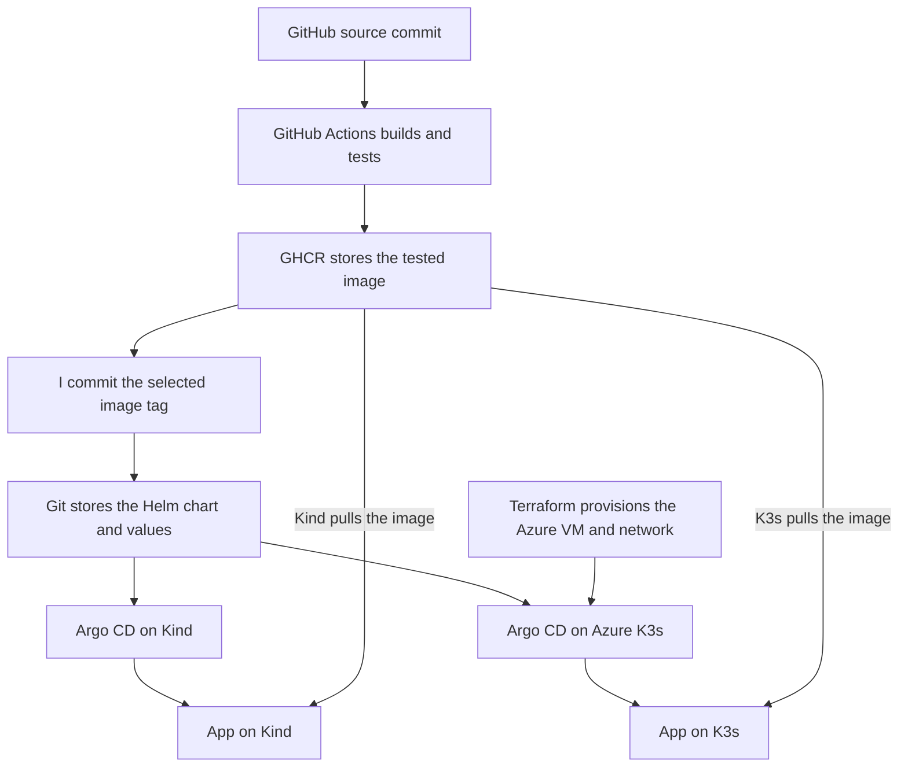

# Cloud-Native DevOps Platform

I built this project to understand what happens between pushing a Git commit and seeing the new version run in Kubernetes. I started with Kind on my laptop, then provisioned a Linux VM on Azure with Terraform and ran the same Helm chart and Argo CD Application on K3s.

The Azure deployment served version `0.2.0`, and both HTTP endpoints returned `200 OK`. I then destroyed the lab with Terraform and confirmed in Azure that the resource group was gone.

## How the delivery pipeline works



Pull requests targeting `main` build the Docker image and smoke-test `/` and `/healthz`. On a push to `main`, a separate publishing job pushes the **same tested image** to GHCR under a `sha-<commit>` tag.

I promote an image by updating its tag in `charts/devops-platform/values-ghcr.yaml` and pushing that change. Argo CD watches `main` and automatically syncs the new desired state. I also enabled self-healing and verified it by scaling the Deployment to two replicas by hand. Argo CD brought it back to the one replica declared in Git.

## Repository layout

| Path | What’s inside |
|---|---|
| `app/` | Python HTTP service and Dockerfile that runs the app as a non-root user |
| `.github/workflows/ci.yml` | Image build, smoke tests, and publishing to GHCR |
| `charts/devops-platform/` | Helm chart, readiness probe, ClusterIP Service, and GHCR image values |
| `gitops/application.yaml` | Argo CD Application used on both Kind and K3s |
| `infra/azure/` | Terraform configuration for the Azure VM and network |

## Run on Kind

Install Docker, Kind, `kubectl`, Helm, and `curl`. Run the commands below from the repository root. If you already have the `devops-platform` cluster or the `argocd` namespace, skip the corresponding creation command.

```bash
helm lint charts/devops-platform
kind create cluster --name devops-platform

kubectl --context kind-devops-platform create namespace argocd
kubectl --context kind-devops-platform -n argocd apply \
  --server-side --force-conflicts \
  -f https://raw.githubusercontent.com/argoproj/argo-cd/v3.6.1/manifests/install.yaml
kubectl --context kind-devops-platform -n argocd get pods
```

Once the Argo CD pods are ready, apply the Application and check its status.

```bash
kubectl --context kind-devops-platform -n argocd apply -f gitops/application.yaml
kubectl --context kind-devops-platform -n argocd get application devops-platform
```

When the Application shows `Synced` and `Healthy`, start a port-forward:

```bash
kubectl --context kind-devops-platform -n devops-platform-gitops \
  port-forward svc/devops-platform 8083:80
```

Leave it running and test both endpoints from a second local terminal:

```bash
curl -fsSi http://127.0.0.1:8083/
curl -fsSi http://127.0.0.1:8083/healthz
```

To remove the dedicated local cluster after testing, run `kind delete cluster --name devops-platform`.

## Run on Azure

I used Sweden Central and one `Standard_B2ls_v2` VM with **2 vCPUs, 4 GiB RAM, Ubuntu 24.04, and a 32-GiB Standard SSD**. Terraform also creates the VNet, subnet, network interface, static public IPv4 address, and security group. The SSH rule limits internet access on port 22 to a single source IPv4 address.

Before deploying, check VM availability, vCPU quota, and prices for your Azure subscription. The commands look up your active subscription and IP addresses when you run them. If you share terminal output, redact those values as `[Azure subscription ID]` and `[IP address]`.

### Provision the VM

You’ll need Azure CLI, Terraform, `curl`, and an SSH key pair. In `infra/azure/vm.tf`, set the path inside `admin_ssh_key.public_key` to your own **public key file**, such as `~/.ssh/id_ed25519.pub`. The SSH example below uses the matching private key, `~/.ssh/id_ed25519`, from your local machine.

From `infra/azure` in your **local terminal**, sign in and select the intended subscription. If `Microsoft.Compute` is unregistered, run `az provider register --namespace Microsoft.Compute --wait` after signing in.

```bash
az login --use-device-code
export ARM_SUBSCRIPTION_ID="$(az account show --query id --output tsv)"

terraform init
terraform fmt -check
terraform validate

ssh_public_ip="$(curl -4fsS --max-time 15 https://api.ipify.org)" &&
  terraform plan -out=lab.tfplan \
    -var="location=swedencentral" \
    -var="ssh_source_cidr=${ssh_public_ip}/32"
```

On a fresh deployment, expect **8 to add, 0 to change, 0 to destroy**. Review the plan, then run `terraform apply lab.tfplan` when you’re ready to start the lab. Applying the saved plan starts provisioning immediately.

After the apply finishes, connect from your local terminal:

```bash
vm_public_ip="$(az network public-ip show \
  --resource-group rg-devops-platform-lab \
  --name pip-devops-platform-lab \
  --query ipAddress --output tsv)" &&
  ssh -i ~/.ssh/id_ed25519 -o IdentitiesOnly=yes "azureuser@${vm_public_ip}"
```

### Install K3s and deploy the app

Run these commands **inside the Azure VM**. I disabled the bundled Traefik ingress controller and ServiceLB because I tested the app through a port-forward.

```bash
curl -fsSL https://get.k3s.io -o /tmp/k3s-install.sh &&
  sudo sh /tmp/k3s-install.sh server --disable traefik --disable servicelb

sudo k3s kubectl get nodes
```

When the node is `Ready`, install Argo CD:

```bash
sudo k3s kubectl create namespace argocd
sudo k3s kubectl -n argocd apply --server-side --force-conflicts \
  -f https://raw.githubusercontent.com/argoproj/argo-cd/v3.6.1/manifests/install.yaml
sudo k3s kubectl -n argocd get pods
```

Once the Argo CD pods are ready, apply the same Application used on Kind:

```bash
sudo k3s kubectl -n argocd apply \
  -f https://raw.githubusercontent.com/Elloumi-A/azure-terraform-gitops-platform/main/gitops/application.yaml

sudo k3s kubectl -n argocd get application devops-platform
```

Wait for `Synced` and `Healthy`, then check the Deployment and start the port-forward:

```bash
sudo k3s kubectl -n devops-platform-gitops get deployment devops-platform -o wide
sudo k3s kubectl -n devops-platform-gitops port-forward svc/devops-platform 8083:80
```

Leave the port-forward running. Open a **second SSH session to the VM** and run both checks there, since the listener is on the VM’s loopback address:

```bash
curl -fsSi http://127.0.0.1:8083/
curl -fsSi http://127.0.0.1:8083/healthz
```

### Clean up Azure

Return to your **local terminal**, go to `infra/azure`, and confirm you’re using the same Azure subscription and region. Review the destroy plan before typing `yes`.

```bash
export ARM_SUBSCRIPTION_ID="$(az account show --query id --output tsv)"

ssh_public_ip="$(curl -4fsS --max-time 15 https://api.ipify.org)" &&
  terraform destroy \
    -var="location=swedencentral" \
    -var="ssh_source_cidr=${ssh_public_ip}/32"
```

After the destroy completes, check directly in Azure:

```bash
az group exists --name rg-devops-platform-lab --output tsv
```

The expected result is `false`. Keep local Terraform state, saved plans, and `.terraform/` out of Git. Commit `.terraform.lock.hcl` so others can use the provider version tested here.

## What I verified

| Check | Observed result |
|---|---|
| GitHub Actions and GHCR | Both smoke tests passed, and CI published the tested image to GHCR. |
| Local rollout | Argo CD deployed version `0.2.0` on Kind after I committed the new image tag. |
| Local self-healing | Argo CD restored one replica after I manually scaled the Deployment to two. |
| Azure infrastructure | Terraform provisioned eight managed resources in Sweden Central. I connected to the VM over SSH using a key pair. |
| Azure Kubernetes | The single K3s node reported `Ready` on `v1.37.2+k3s1`. |
| Azure GitOps | Argo CD v3.6.1 reported `Synced` and `Healthy`. |
| Azure workload | The Deployment had `1/1` replicas ready with GHCR tag `sha-1a34f383c35de6bd58fb20b1d0089b69859c3bbf`. |
| Azure HTTP checks | `/` returned `200 OK` with version `0.2.0`. `/healthz` returned `200 OK` with `{"status": "ok"}`. |
| Azure cleanup | Terraform reported `8 destroyed`. The Azure CLI returned `false` when I checked whether the resource group still existed. |

## Troubleshooting

| What happened | How I resolved it |
|---|---|
| The first CI smoke test failed with curl exit `56` during container startup. | I added bounded retries so the service had time to start. The next CI run passed. |
| Azure rejected network creation in West Europe even though the VM SKU and quota checks passed. | I checked the quota in Sweden Central, ran a provider-level VNet validation there, and generated a fresh Terraform plan. The deployment succeeded. |
| The first K3s node query returned `No resources found`. | The API was responding while the node was still registering. I reran the check and saw `Ready`. |
| `curl` failed from my local WSL2 terminal while the Azure port-forward was running. | I was querying my laptop’s loopback address. I ran the same commands in a second SSH session on the VM and got `200 OK` from both endpoints. |
